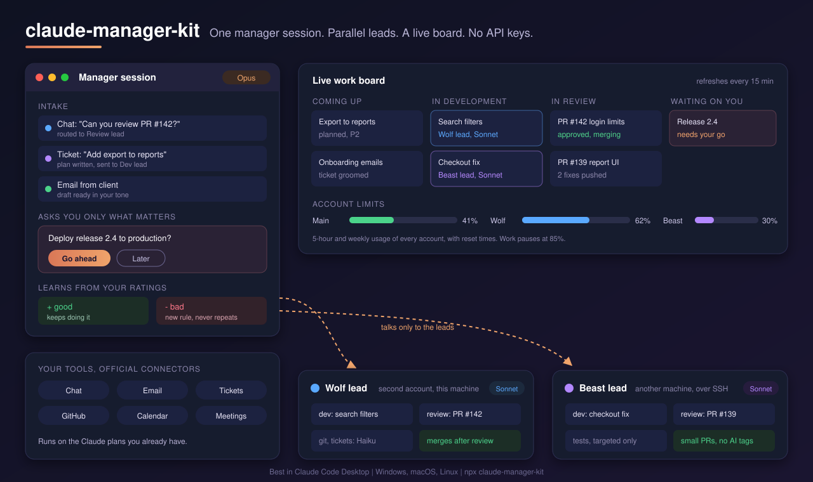

# claude-manager-kit

### Turn the Claude plan you already pay for into a manager that runs your day, with no API keys and no extra bill

A personal manager for **Claude Code Desktop**: it triages your chat, mail and tickets, replies in your tone, sends the hands-on work to parallel Claude accounts and machines, watches your plan limits, and gets better every time you rate it.

<p align="center"></p>

- **No API keys, no API costs.** It only uses the Claude accounts you already have, signed in the normal way. The kit itself makes no network calls.
- **A manager that triages for you.** Chat, mail, tickets and PR requests are sorted into done, ignored, waiting or dispatched. Nothing is left silently.
- **More work in parallel.** Extra Claude accounts on your computer and other machines over SSH run development and reviews while the manager stays free. It checks plan limits before starting work, so nothing stalls at the 5-hour wall.
- **Replies in your voice.** It learns your tone from your own sent messages, adapts to the audience, and asks you first on anything risky.
- **It learns from your ratings.** Rate its work good or bad. Good ratings are kept as what to repeat, every bad rating becomes a written rule, and it re-reads them at every session start. Reinforcement-style learning, with no model training.
- **Safe by default.** It starts in propose-only mode, has an always-ask list (production, money, access, deleting data), and never puts AI attribution in your commits or PRs.

```
npx claude-manager-kit
```

Answer a few plain questions (about 5 minutes), then open the generated folder in Claude Desktop and paste one prompt. Requires Node 18+ and Claude Code. Works on Windows, macOS and Linux.

## Best with Claude Code Desktop

Built for and works best in the **Code tab of the Claude desktop app** (Claude Code Desktop). There the manager runs as one long-lived session, can start and message your other sessions, create scheduled tasks (digests, board refresh, daily learning) and use your connectors.

Terminal-only Claude Code, and Linux (which has no desktop app), work in a **reduced mode**. What is missing there: scheduled tasks and session loops are not created for you (run `/loop` or a cron job by hand), the manager cannot list or message other sessions (it drives leads with `cmk lead` instead), and the board is kept as plain files in `board/` instead of a live artifact.

## Who it is for

People who run software work day to day: developers, QA engineers, engineering leads and managers, plus product owners and anyone who juggles tickets, PRs, reviews, chats and email.

- Run development and reviews in parallel across sessions, accounts and machines.
- Create and groom tickets, and keep the board current.
- Manage work across many sessions without chasing each one.
- Keep up with team messages without being the bottleneck.

## Learning from your ratings

The manager improves from your feedback, like reinforcement learning but made of plain files. There is no model training and no API. It learns through its own rules and memory, which it re-reads.

1. **You rate.** Say "good" or "bad" in the chat, give a correction, or run `cmk rate good "<what>" "<why>"` or `cmk rate bad "<what>" "<why>"` from a terminal.
2. **It logs the rating in the same turn** in `memory/ratings.jsonl`: `{"date","rating":"good|bad","what","why","rule"}`.
3. **Good rating = reward.** It writes down what worked (the approach, tone, timing) as something to keep doing.
4. **Bad rating = penalty.** Something did not happen as you expected. It says what went wrong, finds the cause, and writes a concrete rule in `CLAUDE.md`, `rules.md` or the tone model so the mistake does not repeat. A bad rating without a rule counts as unfinished.
5. **It reviews the log at every session start** and in the weekly report: counts, new rules, and any rule that keeps being broken (so it gets rewritten more sharply).

`cmk doctor` shows your latest ratings and warns about bad ratings that have no rule yet. Autonomy never widens from a good rating: only you change the autonomy modes.

## Safety model

- **No passwords, tokens or API keys are ever asked for, stored or printed.** Accounts sign in with Claude's own
  login. Tools connect through their official connectors or OAuth. SSH uses your own keys.
- Credentials never live in the assistant's home folder. Account logins live in `~/.claude-manager-kit/accounts/<name>/`.
- Every area starts in **propose only** mode: the manager says what it would do and waits.
- A fixed **always-ask list** applies in every mode: production deploys, payments and money, permissions and
  access, deleting data, messages to senior people you list, anything external you mark as sensitive.
- Leads run headless with permission mode `acceptEdits` by default. `bypassPermissions` is used only if you choose it
  in the wizard, with a warning.
- Commits and PRs carry no AI attribution (settings are written for the manager and for every lead account).

## The three setup types

```
Solo                       Multi-account                      Multi-machine
+-----------------+        +-----------------+                +-----------------+
| Manager         |        | Manager         |                | Manager         |
| (your account)  |        | (your account)  |                | (your account)  |
| + subagents     |        +--------+--------+                +--------+--------+
+-----------------+                 | headless claude -p               | ssh + claude -p
                             +------+-------+                   +------+-------+
                             |              |                   |              |
                          Lead "Wolf"    Lead "Lynx"          Lead "Beast"  Lead "Titan"
                          (extra Claude  (extra Claude        (other computer, its own login)
                           account, here) account, here)
```

Mixed setups (accounts and machines together) are allowed. The terminal and Desktop session uses your main
account; leads use the extra accounts or machines. Plan limits are per account, which is the point of extra accounts.

## Install and start

```
npx claude-manager-kit
```

`npx claude-manager-kit setup` does the same. After that use `npx claude-manager-kit <command>`, or install it
globally and use the short alias:

```
npm install -g claude-manager-kit
cmk doctor
```

No Node yet? See the platform steps below.

## Windows, macOS and Linux

Verified on Windows 11 (PowerShell, cmd and Git Bash, paths with spaces and non-ASCII characters). The macOS and Linux steps below are written from the platform documentation and are **not yet tested by the author**; CI runs the unit tests on all three. Please open an issue if a step is wrong.

| | Windows | macOS (untested) | Linux (untested) |
|---|---|---|---|
| Node 18+ | `winget install OpenJS.NodeJS.LTS` | `brew install node` | your package manager or https://nodejs.org (for example `sudo apt install nodejs npm`, or nvm) |
| git | `winget install Git.Git` (Claude Code on native Windows needs Git for Windows) | `xcode-select --install` | `sudo apt install git` |
| Claude Code | PowerShell: `irm https://claude.ai/install.ps1 \| iex` | `curl -fsSL https://claude.ai/install.sh \| bash` | same as macOS |
| Claude Desktop | yes, https://claude.com/download | yes, `/Applications/Claude.app` | **no desktop app**: terminal mode |
| Start the manager | Desktop > Code tab > open the home folder > paste | same | `cd <home> && claude`, paste |
| Clipboard tool | `clip` (built in) | `pbcopy` (built in) | `wl-copy`, `xclip` or `xsel` (install one, or the wizard prints the prompt) |
| Where state lives | `%USERPROFILE%\.claude-manager-kit\` | `~/.claude-manager-kit/` | `~/.claude-manager-kit/` |

You can use any ordinary Claude Code install method (including `npm install -g @anthropic-ai/claude-code`). After installing anything, open a **new** terminal so the PATH is refreshed, then check with `claude --version`.

### Windows

- Use PowerShell, cmd or Git Bash; all three work. After `npm install -g claude-manager-kit`, `cmk` works in each.
- If PowerShell says "running scripts is disabled" when you type `cmk`, either run `cmk.cmd` instead, or allow local scripts once: `Set-ExecutionPolicy -Scope CurrentUser RemoteSigned`.
- In a `.bat` file, start every call with `call cmk ...`, otherwise the batch file stops after the first one.
- Extra accounts: each gets its own config folder under `%USERPROFILE%\.claude-manager-kit\accounts\<name>`; the wizard hands the terminal to `claude` so you can `/login` and `/exit`.
- SSH for multi-machine: install the client (Settings > Optional features > OpenSSH Client). Create a key with `ssh-keygen -t ed25519`. Windows has no `ssh-copy-id`; install your key with:
  `type $env:USERPROFILE\.ssh\id_ed25519.pub | ssh user@host "mkdir -p ~/.ssh && cat >> ~/.ssh/authorized_keys"`.
- If the other machine is Windows: enable the OpenSSH Server feature there. For an administrator account, the key goes into `C:\ProgramData\ssh\administrators_authorized_keys`. The tool detects the default `cmd.exe` shell.

### macOS (untested)

- Claude Desktop is the best experience. Open it, go to the Code tab, open the home folder and paste the starter prompt.
- Enable Remote Login on a Mac that should act as a lead machine: System Settings > General > Sharing > Remote Login.
- SSH keys: `ssh-keygen -t ed25519` then `ssh-copy-id user@host`.
- For non-interactive SSH, `claude` must be on the PATH: put `export PATH="$HOME/.local/bin:$PATH"` in `~/.zshenv` (not only `~/.zshrc`).

### Linux (untested)

- There is no Claude Desktop for Linux, so the manager runs in **terminal mode** (see "Best with Claude Code Desktop" above for what is reduced). Start it with `cd <home> && claude` and paste the starter prompt, or keep it in `tmux` so it survives closing the terminal.
- Install a clipboard tool if you want the prompt copied for you: `sudo apt install wl-clipboard` (Wayland) or `xclip` (X11). Otherwise the wizard prints the prompt.
- SSH keys: `ssh-keygen -t ed25519` then `ssh-copy-id user@host`. Make sure `claude` is on the PATH for non-interactive shells (for example `export PATH="$HOME/.local/bin:$PATH"` near the top of `~/.bashrc`, above the "if not running interactively, return" line).
- `npm install -g` failing with EACCES: use `npm config set prefix ~/.npm-global` and add `~/.npm-global/bin` to your PATH, or just use `npx`.

## What the wizard asks

Defaults are in brackets. It is safe to re-run. `--yes` accepts every default, `--dry-run` writes into a temp folder
and runs no logins, ssh or clipboard.

1. **Environment check**: Node, Claude Code CLI, Claude Desktop, git, gh (optional), ssh (if needed), with fix hints.
2. **About you**: name, role, company type (free text, stored locally), time zone, working hours, languages.
3. **Your assistant**: a name (random fun default) and its home folder (`~/<name>`).
4. **Setup type**: solo, multi-account or multi-machine (or both). For each extra account the wizard creates its config
   dir, hands the terminal to `claude` so you can `/login` and `/exit`, then verifies with `claude -p "/usage"`.
   For each machine it tests `ssh -o BatchMode=yes ... claude --version` and, if that fails, explains why and prints
   `npx claude-manager-kit join` to run on that machine.
5. **Tools** per role (or none): chat (Google Chat, Slack, Teams), mail (Gmail, Outlook), tasks (ClickUp, Jira, Linear,
   Asana, GitHub Issues), code (GitHub, GitLab), calendar, and a meeting transcripts folder. claude.ai connectors cannot
   be verified from a terminal: enable them at claude.ai > Settings > Connectors; they are recorded as "to verify" and the
   manager checks them on its first run. Local MCP servers and CLIs are added and verified by the wizard.
6. **Autonomy** per area: propose only, reply when the context is known, or act within guardrails. Plus your senior
   people and sensitive topics.
7. **Schedules** (optional): digests, board refresh, daily tone learning, weekly report. The manager creates them as
   Claude Desktop scheduled tasks on its first run.
8. **Models**: manager `opus` (planning and decisions only), leads and development `sonnet`, mechanical work `haiku`.
9. **Summary**, confirm, write, run `doctor`, copy the starter prompt to the clipboard, and try to open Claude Desktop.

Then: **Claude Desktop > Code > open folder `<home>` > paste.** On Linux (no Desktop): `cd <home> && claude`, paste.

## The home folder

```
<home>/
  manager-kit.json     config: profile, setup type, accounts, machines, tools, autonomy, schedules, models
  CLAUDE.md            the manager playbook (generated)
  .claude/settings.json  model opus, no AI attribution
  rules.md             triage rules and guardrails (yours to edit; never overwritten)
  tone/                tone model, examples, feedback (filled over time)
  memory/state.md      the manager's notebook
  memory/ratings.jsonl good and bad ratings and the rule learned from each
  board/               open work, done, jobs, plan limits
  leads/LEAD-RULES.md  rules every lead follows
  leads/<name>/        brief-start.md and tasks.md per lead
  meetings/            meeting notes (when a meeting source is set)
  STARTER-PROMPT.md    the first message for the manager session
  README.md            what each file is
```

## Moving to a new machine or account

Copy the home folder, then run `npx claude-manager-kit setup --home <path>`. It keeps the learned files (tone,
memory, ratings, tasks, rules) and only re-does accounts, machines and tool connections, because those belong to
each computer. A changed `CLAUDE.md` is saved as `CLAUDE.md.bak` before it is regenerated.

## Helper commands

```
cmk doctor                                   re-check environment, accounts, machines, tools, recent ratings
cmk update [--home <path>] [--yes]           refresh the playbook from the latest templates, keep everything learned
cmk rate good|bad "<what>" ["<why>"] [--rule "<rule>"]   log a rating the manager learns from
cmk usage [--json]                           plan usage of every account and machine; writes board/limits.json
cmk lead start <lead> <job> <brief-file> [--model sonnet|opus|haiku] [--cwd <dir>] [--wait]
cmk lead reply <job> <brief-file> [--model ...]   continue a job (--resume, same folder)
cmk lead status [job]
cmk lead result <job>
cmk lead stop <job>
cmk join [--name <name>] [--yes]             run on a remote machine to set up its lead
cmk setup [--home <path>] [--yes] [--dry-run]
```

Jobs run in the background. Their files live in `~/.claude-manager-kit/jobs/<job>/`: `prompt.txt`, `status.txt`
(running, done, failed, stopped), `session.txt`, `result.md`, `history.md`, `err.log`. The brief is always sent on
stdin, never on a command line. For a machine lead the job runs `claude -p` over SSH with the brief streamed to it.
A result that ends with a `QUESTION:` line is a question for the manager.

Environment variables: `CMK_HOME` (assistant home), `CMK_ROOT` (where accounts and jobs live), `CMK_ASCII=1`
(plain ASCII symbols), `CMK_CLAUDE_BIN` and `CMK_CLAUDE_BIN_ARGS` (use a different claude executable).

## Uninstall

1. Delete the home folder (it holds only what the assistant learned).
2. Delete `~/.claude-manager-kit/` (account config dirs and job files). Signing out of an extra account first
   (`claude` with its `CLAUDE_CONFIG_DIR`, then `/logout`) is optional.
3. `npm uninstall -g claude-manager-kit` if you installed it globally.
4. Remove the Claude Desktop scheduled tasks the manager created, and any MCP server you added
   (`claude mcp remove google-chat`).

## FAQ

**Does it need an API key?** No. It uses your Claude plan through Claude Code and Claude Desktop.

**Does it send my data anywhere?** The tool itself makes no network calls. Claude and your connectors work as usual.
The config (including company type and names) stays on your disk.

**Why extra accounts?** Plan limits are per account. Leads on their own accounts keep the manager's budget free.
Use accounts you are allowed to use under Anthropic's terms.

**How do I stop a runaway lead?** `cmk lead stop <job>`, or stop at 85 percent of the 5-hour limit: the playbook tells
the manager to check `cmk usage` before starting work.

**Windows notes?** `claude` may be `claude.cmd` or `claude.exe`; the tool finds it with `where`. For a Windows
machine reached over SSH, the OpenSSH default shell (cmd.exe) is detected automatically.

**Can I edit the playbook?** Edit `rules.md` freely. `CLAUDE.md` is regenerated by setup; put lasting rules in
`rules.md` or in `memory/state.md`.

## Development

```
npm test        # node --test
npm run check   # node --check on every file
```

## License

MIT
